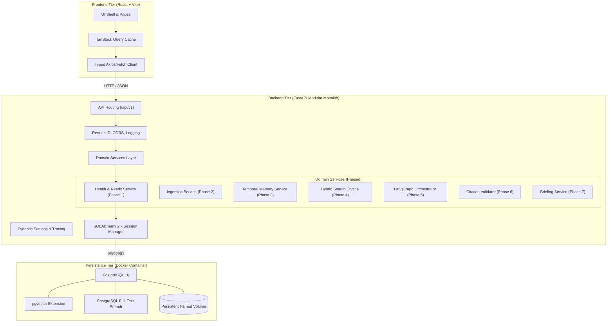

# 02 — System Architecture

## 1. Architectural Style
The Catalist Meeting Intelligence Agent is designed as a **Modular Monolith** with a clear separation of concerns across presentation, API routing, business services, data access, and infrastructure persistence.

---

## 2. Component Boundaries and Responsibilities

### 2.1 Backend Layers
1. **`app/api/v1/`**:
   - HTTP route handlers only.
   - Parses input requests via Pydantic schemas.
   - Injects dependencies (`get_db`, `get_settings`).
   - Delegates business logic to services.
2. **`app/services/`**:
   - Encapsulates pure business logic.
   - Independent of HTTP transport (can be invoked by CLI or background workers).
3. **`app/core/`**:
   - System settings (`config.py`).
   - Structured JSON logging (`logging.py`).
   - Global exception handlers (`exceptions.py`).
   - Request-ID and timing middleware (`middleware.py`).
   - Observability and LangSmith hooks (`tracing.py`).
4. **`app/db/` & `app/models/`**:
   - SQLAlchemy 2.x Declarative Base and Async/Sync session factories.
   - Alembic migration scripts.

### 2.2 Frontend Architecture
- Built with **React 18**, **TypeScript**, and **Vite**.
- Styled using **Tailwind CSS** with accessible design tokens.
- **TanStack Query** manages asynchronous server state, polling intervals, and error retries.
- **React Router** manages client-side view navigation.

---

## 3. Scale Target: 10,000-Meeting Architecture
When scaling from 138 meetings (~676,000 words) to 10,000 meetings (~50,000,000 words / ~2,500,000 speaker turns):
1. **Storage**: Relational metadata and exact turns are partitioned or indexed by `team_id` and `meeting_id`.
2. **Indexing**:
   - GIN indexes on `tsvector` column for sub-second keyword matching across 2.5 million turns.
   - HNSW index on pgvector embeddings for sub-50ms vector cosine distance lookups.
3. **Query Bounding**: Agent queries never retrieve unbound datasets. Multi-hop searches retrieve narrow top-k candidates per step (e.g. top-15 turns per meeting sequence), preventing LLM context bloat.
