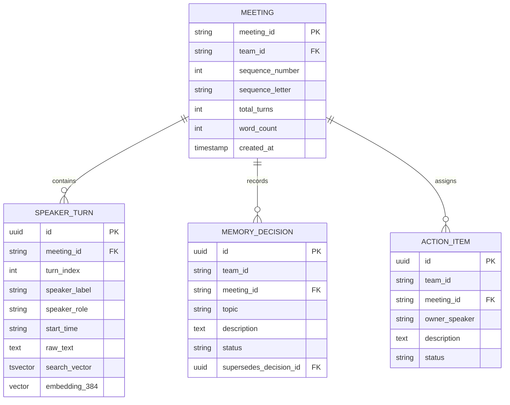

# 03 — Data and Memory Design

## 1. Core Principles
1. **Transcript Source-of-Truth**: The raw transcript text as spoken is the immutable source of truth. It must never be cleaned, summarized, or altered upon storage.
2. **Speaker Turn as Canonical Evidence Unit**: The irreducible unit of evidence is a single speaker turn, containing:
   - `meeting_id`: e.g. `TS3006a`
   - `team_id`: e.g. `TS3006`
   - `sequence_id`: Meeting letter index (1=a, 2=b, 3=c, 4=d)
   - `speaker_label`: e.g. `Speaker B`
   - `speaker_role`: e.g. `Project Manager` (when identified)
   - `start_time`: e.g. `00:04:12`
   - `turn_index`: Sequential integer index within the transcript
   - `text`: Verbatim transcript string
3. **Temporal Awareness**: Decisions change over time. Meeting *b* may revise a concept from *a*; meeting *c* may cut a feature due to budget; meeting *d* may finalize it. The memory model must track chronological sequence.

---

## 2. Planned Data Schema (Phase 2 & Phase 3)

---

## 3. Short-Term vs. Long-Term Memory Design
- **Short-Term Memory (Working Context)**: Held in the LangGraph agent state during a single query execution. Carries current hypotheses, extracted evidence candidates, and search history across iterations.
- **Long-Term Memory (Persistent Graph / Relational)**: Stored in PostgreSQL. Extracts semantic entities, decision lifecycles, and open action items linked back to exact speaker turn IDs.

---

## 4. Phase 1 Implementation Status
- **Implemented Now**: Alembic baseline configuration with pgvector extension activation.
- **Deferred to Phase 2**: `meetings` and `speaker_turns` relational tables, tsvector generation, embedding columns, and ingestion pipeline.
- **Deferred to Phase 3**: Structured temporal decision and action item memory models.

