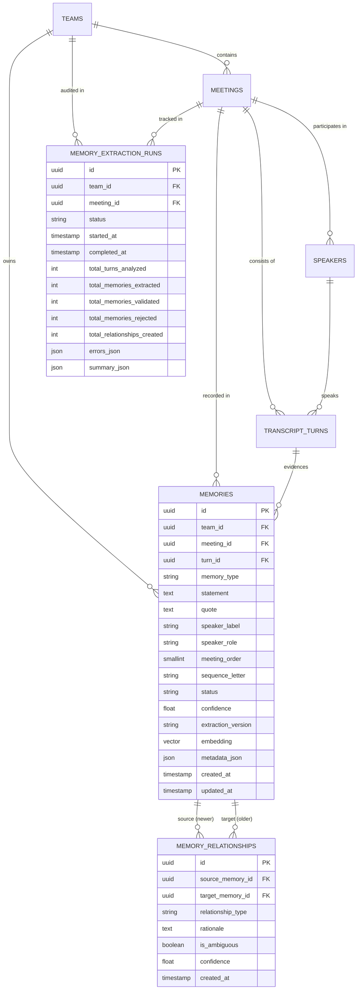

# 03 — Data and Memory Design

## 1. Core Principles
1. **Transcript Source-of-Truth**: The raw transcript text as spoken is the immutable source of truth. It must never be cleaned, summarized, or altered upon storage.
2. **Speaker Turn as Canonical Evidence Unit**: The irreducible unit of evidence is a single speaker turn, containing:
   - `meeting_id`: e.g. `TS3006a`
   - `team_id`: e.g. `TS3006`
   - `sequence_id`: Meeting letter index (1=a, 2=b, 3=c, 4=d)
   - `speaker_label`: e.g. `Speaker B`
   - `speaker_role`: e.g. `Project Manager` (when identified)
   - `start_time`: e.g. `00:04:12`
   - `turn_index`: Sequential integer index within the transcript
   - `text`: Verbatim transcript string
3. **Temporal Awareness & Historical Immutability**: Decisions change over time. Meeting *b* may revise a concept from *a*; meeting *c* may cut a feature due to budget; meeting *d* may finalize it. The memory model preserves every historical state, tracking chronological evolution via directed relationship edges. Older memories are never overwritten or deleted.
4. **Deterministic Evidence Citations**: Every atomic memory cites an exact verbatim quotation of at least 6 consecutive words from a specific supporting transcript turn. Fabricated, hallucinated, or modified quotations are strictly rejected.

---

## 2. Implemented Data Schema (Phase 2 & Phase 3)

---

## 3. Atomic Memory Types

- `DECISION`: Concrete design, architectural, technical, marketing, or project decisions, including revisions to prior decisions.
- `ACTION`: Explicit task commitments, action assignments, next steps, and their assigned owners.
- `PREFERENCE`: Customer, user, or stakeholder preferences and aesthetic choices.
- `REQUIREMENT`: Functional, mechanical, electrical, financial, or user requirements.
- `DISAGREEMENT`: Active disputes, conflicting viewpoints, arguments, or unresolved issues.
- `ENTITY`: Core product components, physical materials, or target market segments.

---

## 4. Directed Temporal Relationships

Directed edges connect a newer memory (`source_memory_id`) back to an earlier memory (`target_memory_id`):
- `supersedes`: A newer decision replaces an earlier decision on the same topic. The prior decision is transitioned to `status="superseded"` while the newer remains `status="current"`.
- `updates`: A newer statement refines, narrows, or expands upon prior knowledge without complete replacement.
- `resolves`: An action item is completed or a prior disagreement is resolved by team consensus.
- `reopens`: A previously settled topic or closed disagreement is re-examined in a later meeting.
- `supports`: Later findings or discussions reaffirm an earlier decision.
- `contradicts`: An opposing statement conflicts with an earlier assertion without formal supersession.

### Ambiguity Preservation
When evidence is tentative or inconclusive, the relationship is created with `is_ambiguous=True`. In this state, lifecycle statuses are left unaltered to avoid premature supersession.

---

## 5. Exact Citation Validation Protocol

The `EvidenceValidator` enforces:
1. **Length Gate**: The quotation must contain at least 6 words.
2. **Verbatim Substring**: The normalized quotation must appear verbatim in `TranscriptTurn.raw_text`.
3. **Speaker Consistency**: The stated speaker label must match the speaker associated with the referenced turn.
4. **Action Ownership Guard**: If an action specifies an owner, the owner must be explicitly named or addressed in the utterance.

---

## 6. Hybrid Retrieval and Memory Feeding (Phase 4)

The temporal memory store directly feeds into the Phase 4 `HybridRetrievalService`:
1. **Direct Memory Retrieval**: Queries targeting decisions, action owners, requirements, or disagreements query the `memories` table directly using lexical statement/quote matching and semantic similarity over `Memory.embedding`.
2. **Temporal Relationship Graph Traversal**: When an atomic memory is matched (e.g. an initial design decision from Meeting `a`), the retrieval pipeline traverses its directed relationships:
   - Outgoing `supersedes`, `updates`, `resolves`: Identifies newer replacement decisions or resolutions in Meeting `c` or `d`.
   - Incoming `superseded_by`, `updated_by`, `reopened_by`: Identifies the origin rationale if a newer memory is matched first.
3. **Evidence Packaging**: The traversed memory cluster is bundled into `MemoryEvidenceItem` objects containing both the exact transcript quotation, meeting reference, turn index, and complete chronological relationship graph (`linked_memory_ids`), providing the downstream reasoning agent with temporal context.
