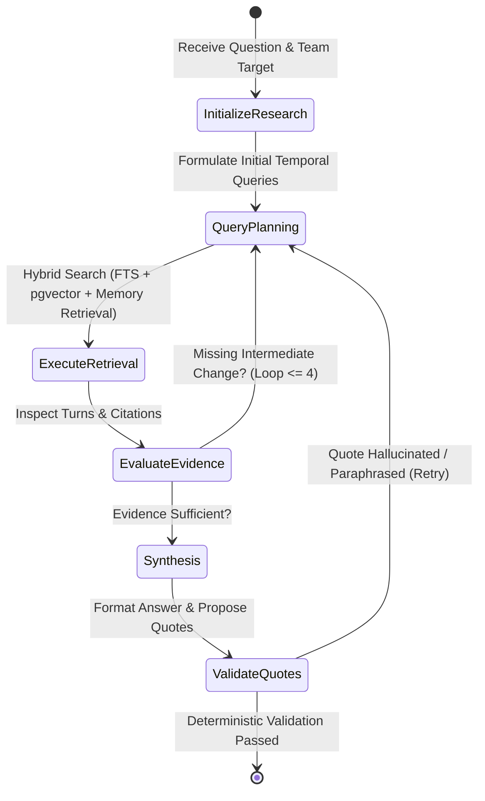

# 04 — Retrieval and Agent Design

## 1. Overview
Answering complex questions across 138 meetings requires an iterative, multi-hop research strategy. For example:
> *"Team TS3006 planned both an LCD screen and speech recognition. When the costs forced a cut, which of the two did they drop, which did they keep, and what reason was given for keeping it?"*

Answering this cannot be solved by a single vector search; it requires:
1. Finding where both features were initially proposed (meeting `a` or `b`).
2. Finding the budget discussion where costs were cut (meeting `c`).
3. Identifying the explicit decision and rationale (meeting `c` or `d`).
4. Traversal of temporal memory links (`supersedes`, `updates`) connecting the final decision to the initial proposal.

---

## 2. Memory Retrieval Service (Implemented in Phase 3)

The `MemoryRetrievalService` provides structured filtering and temporal graph traversal:
- **Filtering Dimensions**: `team_code`, `meeting_code`, `meeting_order`, `sequence_letter`, `memory_type`, `status`.
- **Lexical Substring Search**: Substring filtering across atomic statements and ground-truth quotations.
- **Eager Relationship Traversal**: Automatically populates `outgoing_relationships` and `incoming_relationships` to surface the evolutionary trajectory of decisions.
- **REST & CLI Interfaces**: Accessible via `/api/v1/memory/search`, `/api/v1/memory/{id}`, and `catalist search-memory`.

---

## 3. Hybrid Retrieval Architecture (Implemented in Phase 4)

We employ a unified hybrid retrieval engine combining:
1. **Deterministic Query Processor (`QueryProcessor`)**:
   - Extracts target team codes (e.g. `TS3006`, `ES2003`), meeting IDs, speaker designations, roles, domain concepts, and temporal intent.
   - Generates cleaned search strings for full-text search.
2. **Lexical Full-Text Search**: PostgreSQL `tsvector` with websearch/tsquery matching technical terms ("LCD", "speech recognition", "titanium", "rubber").
3. **Dense Vector Search**: 384-dimensional cosine distance via `pgvector` on embeddings generated by local `all-MiniLM-L6-v2`.
4. **Rank Fusion**: **Reciprocal Rank Fusion (RRF)**:
   $$RRF\_Score(d) = \sum_{m \in M} \frac{w_m}{k + rank_m(d)}$$
   where $k=60$ standard constant, combining ranks from lexical and semantic passes into a unified candidate pool with configurable channel weights.
5. **Unified Evidence Pack**: Packages retrieved turns, verbatim quotes, related temporal memories, unresolved disagreements, and cross-meeting evidence distribution.

---

## 4. LangGraph Stateful Research Agent (Phase 5)

### Agent Guardrails and Bounded Execution
- Maximum search iterations: 4 cycles.
- Token context budget per cycle: <= 3,500 tokens.
- Strict isolation: Agents only query turns within the relevant team or cross-team scope requested by the user.

---

## 5. Phase Boundaries
- **Implemented in Phase 1**: Observability hooks, LangSmith tracing configuration.
- **Implemented in Phase 2**: Transcript dataset storage, PostgreSQL tsvector, and local embeddings.
- **Implemented in Phase 3**: Temporal memory schema, exact evidence validator, decision supersession engine, memory extraction service, paginated memory retrieval service, and CLI/REST endpoints.
- **Implemented in Phase 4**: Hybrid retrieval pipeline (`HybridRetrievalService`), Query Processor (`QueryProcessor`), RRF rank fusion (`reciprocal_rank_fusion`), REST endpoints (`/api/v1/retrieval/*`), CLI subcommand (`catalist retrieve`), and comparative evaluation harness (`retrieval_eval.py`).
- **Deferred to Phase 5**: LangGraph state machine, search tools, and agent loops.
