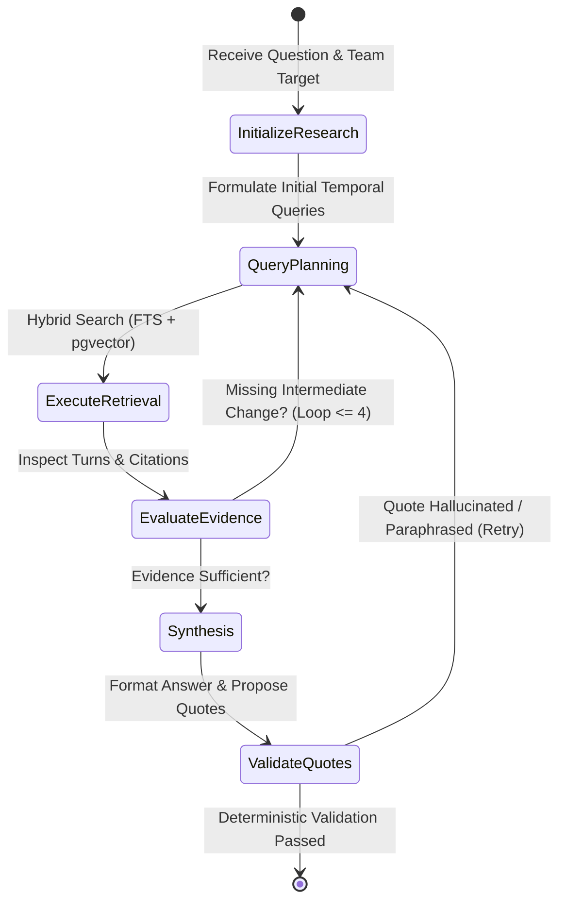

# 04 — Retrieval and Agent Design

## 1. Overview
Answering complex questions across 138 meetings requires an iterative, multi-hop research strategy. For example:
> *"Team TS3006 planned both an LCD screen and speech recognition. When the costs forced a cut, which of the two did they drop, which did they keep, and what reason was given for keeping it?"*

Answering this cannot be solved by a single vector search; it requires:
1. Finding where both features were initially proposed (likely meeting `a` or `b`).
2. Finding the budget discussion where costs were cut (likely meeting `c`).
3. Identifying the explicit decision and rationale (meeting `c` or `d`).

---

## 2. Hybrid Retrieval Architecture (Phase 4)
We employ a hybrid retrieval engine combining:
1. **Lexical Full-Text Search**: PostgreSQL `tsvector` with websearch/tsquery matching technical terms ("LCD", "speech recognition", "titanium", "rubber").
2. **Dense Vector Search**: 384-dimensional cosine distance via `pgvector` on embeddings generated by local `all-MiniLM-L6-v2`.
3. **Rank Fusion**: **Reciprocal Rank Fusion (RRF)**:
   $$RRF\_Score(d) = \sum_{m \in M} \frac{1}{k + rank_m(d)}$$
   where $k=60$ standard constant, combining ranks from lexical and semantic passes into a unified candidate pool.

---

## 3. LangGraph Stateful Research Agent (Phase 5)

### Agent Guardrails and Bounded Execution
- Maximum search iterations: 4 cycles.
- Token context budget per cycle: <= 3,500 tokens.
- Strict isolation: Agents only query turns within the relevant team or cross-team scope requested by the user.

---

## 4. Phase Boundaries
- **Implemented Now (Phase 1)**: LangSmith tracing configuration hooks, safe fallback when tracing is disabled.
- **Deferred to Phase 4**: Hybrid retrieval service and RRF ranking algorithms.
- **Deferred to Phase 5**: LangGraph state machine, search tools, and agent loops.

