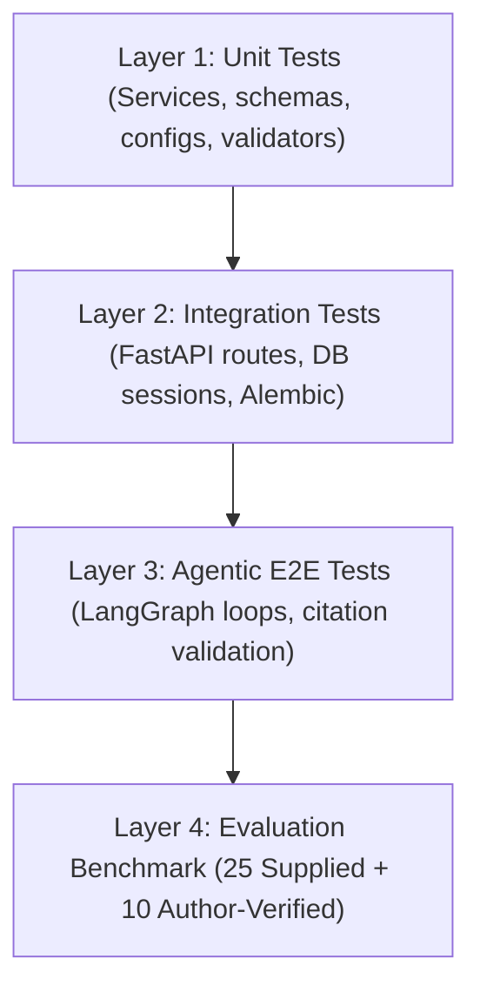

# 07 — Testing and Evaluation Plan

## 1. Testing Strategy and Layers

The testing strategy encompasses four rigorous layers:

### 1.1 Backend Foundation Tests (Phase 1)
- Application startup and route discovery.
- Health endpoint returns 200 and safe metadata.
- Readiness endpoint accurately detects database up vs. database down.
- Request ID middleware generates UUID when absent, echoes valid incoming ID.
- Centralized exception handlers return standardized error payloads without tracebacks.
- Configuration validation fails on invalid types or missing required values with clear messages.
- LangSmith unconfigured / disabled mode runs cleanly without error.
- Database session dependency can be overridden in test fixtures.

### 1.2 Frontend Foundation Tests (Phase 1)
- Overview page renders product title, mission, and workflow pipeline.
- System status panel handles loading, healthy, degraded, and network failure states.
- TanStack Query hook handles polling and error catching.
- Client-side navigation renders routes without unhandled exceptions.

---

## 2. Assessment Benchmark Protocol (Phase 9)

### 2.1 The 25 Supplied Assessment Questions
- Evaluated against `questions.json`.
- Graded on:
  1. Factual accuracy of the 1–3 sentence answer.
  2. Citation validity: exact quote matching stored turn, >= 6 words, correct `meeting_id`.
  3. Strict adherence to submission JSON schema.

### 2.2 The 10 Independently Authored & Manually Verified Questions
- Written by the author and verified by manual transcript inspection.
- Provides a controlled ground-truth testbed to evaluate agent recall, precision, and multi-hop reasoning.

### 2.3 Failure Analysis Protocol
- Mandatory documentation of at least 3 genuine failures encountered by the agent.
- Root cause categorization: retrieval miss, temporal resolution error, speech disfluency confusion, or validation rejection.

### 2.4 1,000-Meeting Scale Estimation
- Calculation of ingestion runtime, embedding storage (pgvector bytes), token consumption, and operational cost across 1,000 meetings (~5,000,000 words).
