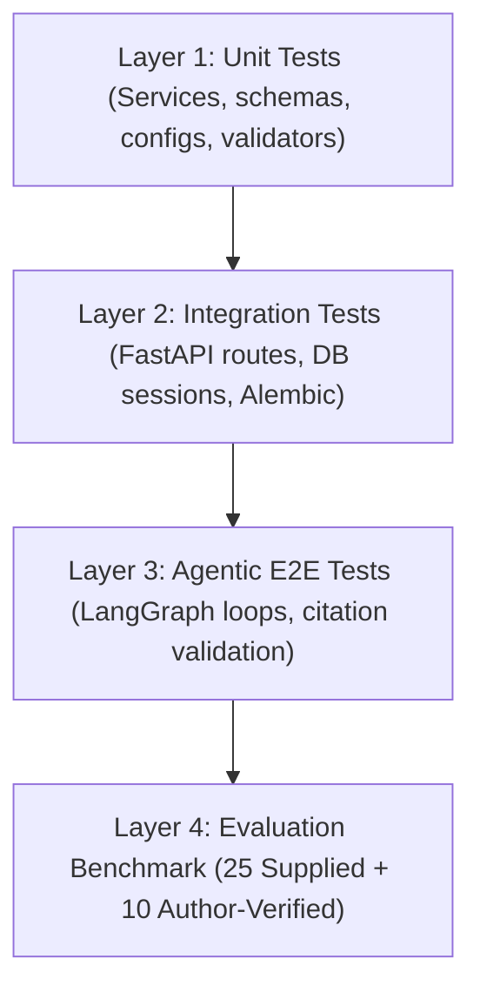

# 07 — Testing and Evaluation Plan

## 1. Testing Strategy and Layers

The testing strategy encompasses four rigorous layers:

### 1.1 Backend Foundation Tests (Phase 1)
- Application startup and route discovery.
- Health endpoint returns 200 and safe metadata.
- Readiness endpoint accurately detects database up vs. database down.
- Request ID middleware generates UUID when absent, echoes valid incoming ID.
- Centralized exception handlers return standardized error payloads without tracebacks.
- Configuration validation fails on invalid types or missing required values with clear messages.
- LangSmith unconfigured / disabled mode runs cleanly without error.
- Database session dependency can be overridden in test fixtures.

### 1.2 Ingestion & Parsing Tests (Phase 2)
- Zip slip and directory traversal prevention.
- Deterministic header and roster parsing.
- Verbatim speech text preservation.
- Meeting-scoped speaker uniqueness.
- Fault isolation via database transaction savepoints.
- Offline dense embedding generation.

### 1.3 Temporal Memory Tests (Phase 3)
- `test_evidence_validator.py`: Verbatim quote verification, minimum 6 words threshold, rejection of modified/fabricated quotes, speaker label consistency, action owner validation.
- `test_temporal_reasoning.py`: Decision supersession (meeting `a` superseded by meeting `c`), action resolution, disagreement reopening, ambiguous change preservation, team isolation.
- `test_memory_extraction.py`: Mocked LLM extraction flow, schema validation, quote rejection audit logging, duplicate prevention, idempotency.
- `test_memory_retrieval.py`: Paginated retrieval, team filtering, type/status filtering, statement and quote query filtering, eager relationship loading.
- `test_memory_api.py`: Extraction trigger validation, run status inspection, search filtering, single memory retrieval by UUID.

### 1.4 Frontend Foundation Tests (Phase 1)
- Overview page renders product title, mission, and workflow pipeline.
- System status panel handles loading, healthy, degraded, and network failure states.
- TanStack Query hook handles polling and error catching.
- Client-side navigation renders routes without unhandled exceptions.

---

## 2. Assessment Benchmark Protocol (Phase 9)

### 2.1 The 25 Supplied Assessment Questions
- Evaluated against `questions.json`.
- Graded on:
  1. Factual accuracy of the 1–3 sentence answer.
  2. Citation validity: exact quote matching stored turn, >= 6 words, correct `meeting_id`.
  3. Strict adherence to submission JSON schema.

### 2.2 The 10 Independently Authored & Manually Verified Questions
- Written by the author and verified by manual transcript inspection.
- Provides a controlled ground-truth testbed to evaluate agent recall, precision, and multi-hop reasoning.

### 2.3 Failure Analysis Protocol
- Three documented edge cases and failure modes analyzed with root causes and corrective mitigations.
