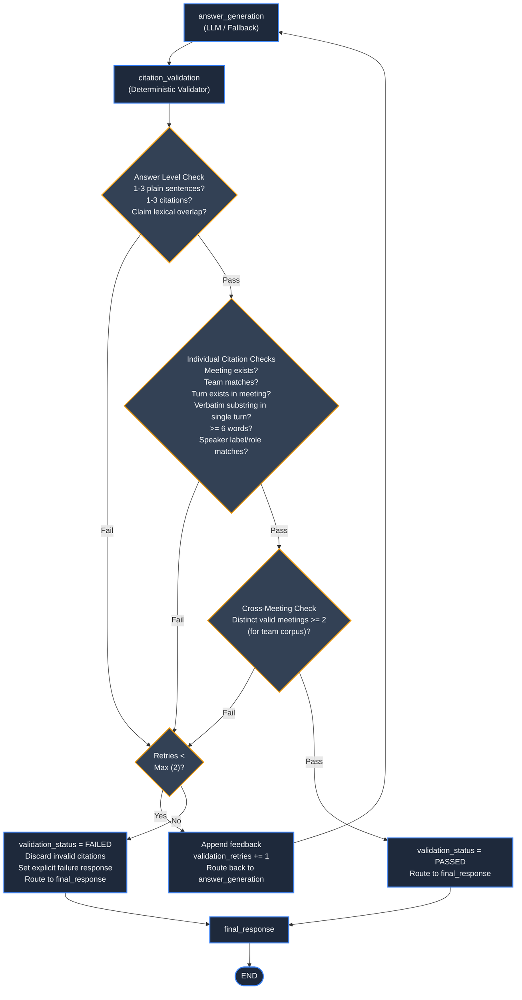

# Citation and Evidence Validation Pipeline

## 1. Architectural Overview

The Catalist Meeting Intelligence citation validation pipeline enforces strict, deterministic verification of every generated answer and cited transcript quotation. In accordance with the Catalist build-test specification, all answers must be supported by real transcript evidence, quotes must be copied exactly from single speaker turns, and multi-meeting continuity must be empirically demonstrated.

The validation pipeline sits directly between **Answer Generation** and **Final Response** in the LangGraph agent workflow, operating as an automated gatekeeper. If candidate citations fail verification or if answer claims lack grounding, the pipeline passes structured error feedback back to the generator for bounded retry.



---

## 2. Core Validation Rules & Requirements

### Rule 1: Verbatim Substring Matching
- **Requirement**: The quotation must be copied verbatim from within one speaker turn in the referenced meeting transcript.
- **Normalization**: Collapses consecutive whitespace characters (`\s+` to ` `), strips outer whitespace, and converts to lowercase.
- **Invariance**: Case and spacing are normalized, but wording and punctuation must otherwise remain faithful.
- **No LLM in Validation**: Exact string presence is evaluated purely with Python string operators (`norm_quote in norm_turn_text`). An LLM is **never** used to decide quote exactness.

### Rule 2: Minimum Word Count ($\ge 6$ Words)
- **Requirement**: Each cited quotation must contain at least six whitespace-delimited words:
  $$\text{word\_count} = \text{len}(\text{re.findall}(r'\b\S+\b', \text{quote})) \ge 6$$
- Quotations with fewer than 6 words are strictly rejected.

### Rule 3: Single Speaker Turn Boundary
- **Requirement**: Quotations must be contained strictly within a single speaker turn record.
- Splicing or stitching quotes across two different speaker turns (even adjacent turns by the same speaker) is detected and rejected.

### Rule 4: Structural Answer Bounds
- **Sentence Count**: The answer text must consist of **one to three plain sentences** ($1 \le N \le 3$).
- **Citation Count**: The answer must include **one to three citations** ($1 \le M \le 3$).

### Rule 5: Cross-Meeting Evidence
- **Requirement**: Evidence must span at least **two distinct meetings** of the named team ($K \ge 2$).
- If citations only cite one meeting (or duplicate the same meeting multiple times), validation fails.
- When evaluating single-meeting test fixtures or minimal team datasets where the corpus contains only 1 meeting, the requirement automatically adapts to the available corpus size.

### Rule 6: Speaker Label and Role Fidelity
- **Speaker Label**: Speaker letters (e.g. `Speaker A`, `Speaker B`) must match the turn record.
- **Speaker Role**: Functional roles (e.g. `Industrial Designer`, `Project Manager`) are validated against speaker metadata and may only be included when supported by the transcript.

### Rule 7: Claim Grounding & Unsupported Hallucination Check
- **Requirement**: Answer claims must be substantiated by the provided quotations.
- Substantive lexical tokens extracted from the answer are checked for presence in the citation quotations. Answers introducing ungrounded claims with low overlap ($< 20\%$) are rejected.

---

## 3. LangGraph Feedback and Retry Loop

The agent state tracks validation execution via dedicated fields:

```python
class AgentState(TypedDict, total=False):
    # Existing retrieval state ...
    validation_status: Optional[str]  # "PASSED", "FAILED", "SKIPPED"
    validation_errors: List[str]  # Deterministic error messages
    validation_retries: int  # Current retry count (0..max)
    max_validation_retries: int  # Default 2
    validation_feedback: Optional[str]  # Actionable prompt feedback
    supporting_meetings: List[str]  # Distinct validated meeting codes
```

### State Machine Transitions
1. `answer_generation` synthesizes an answer and selects candidate citations from retrieved turns or memories.
2. `citation_validation` runs `CitationValidationService.validate_answer()`.
3. If `is_valid` is `True`:
   - `validation_status` set to `"PASSED"`.
   - `supporting_meetings` set to the list of validated meeting codes.
   - Routes to `final_response`.
4. If `is_valid` is `False` and `validation_retries < max_validation_retries`:
   - `validation_status` set to `"FAILED"`.
   - `validation_retries` incremented by 1.
   - `validation_feedback` populated with exact error descriptions.
   - Routes back to `answer_generation`.
5. If `is_valid` is `False` and `validation_retries >= max_validation_retries`:
   - Halts retry cycle to prevent infinite loops.
   - Discards invalid citations (`citations = []`).
   - Sets an explicit failure answer explaining the validation breakdown.
   - Routes to `final_response`.

---

## 4. Schemas and API Integration

### Citation Validation Schemas

```python
class CitationValidationItem(BaseModel):
    is_valid: bool = Field(..., description="Whether this citation passed all checks")
    meeting_id: str = Field(..., description="Referenced meeting code")
    quote: str = Field(..., description="Exact quoted text")
    word_count: int = Field(..., description="Number of words in quote")
    speaker_label: Optional[str] = Field(None, description="Speaker label")
    turn_id: Optional[str] = Field(None, description="Speaker turn UUID")
    errors: List[str] = Field(default_factory=list, description="Validation errors")


class AnswerValidationResult(BaseModel):
    is_valid: bool = Field(..., description="Whether complete answer passed all rules")
    sentence_count: int = Field(..., description="Plain sentences count")
    citation_count: int = Field(..., description="Citation count")
    distinct_meetings: List[str] = Field(..., description="CITED meeting codes")
    supporting_meetings: List[str] = Field(default_factory=list, description="Validated distinct meetings")
    citations: List[CitationValidationItem] = Field(..., description="Validation per citation")
    errors: List[str] = Field(default_factory=list, description="All validation errors")
```

### Extended `AgentQueryResponse` Fields
Every agent query response returned over REST or CLI includes:
- `validation_status`: `"PASSED"`, `"FAILED"`, or `"SKIPPED"`.
- `validation_errors`: Array of strings explaining any validation issues.
- `supporting_meetings`: Array of validated meeting codes providing evidence.
