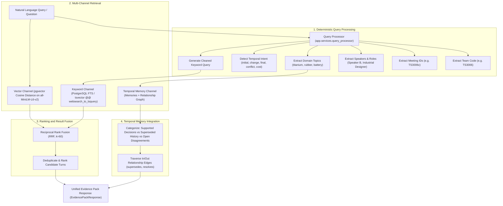

# Hybrid Retrieval Pipeline Architecture

## 1. Overview and Core Philosophy

The Hybrid Retrieval Pipeline combines lexical precision, semantic vector similarity, and temporal memory graphs into unified, cross-meeting evidence packs. 

TV remote design in the AMI Meeting Corpus spans 3 to 4 sequential meetings (`a` through `d`). Complex questions frequently involve:
- Tradeoffs between multiple technical features (e.g. LCD display vs speech recognition).
- Multi-meeting decision evolution (e.g. titanium proposed in meeting `a`, cost cut in meeting `c`, rubber adopted in meeting `d`).
- Cross-meeting action item follow-ups and disagreement resolutions.

A single search method is insufficient:
- **Keyword Search (PostgreSQL FTS)** excels at exact technical terms ("LCD", "titanium", "kinetic", "433 MHz") and speaker designations.
- **Vector Search (pgvector + all-MiniLM-L6-v2)** captures conceptual intent, synonymy, paraphrasing, and semantic queries ("methods to locate lost device", "budget overrun adjustments").
- **Temporal Memory Retrieval** surfaces persistent decisions, superseded choices, and open disputes with directed relationship edges.
- **Reciprocal Rank Fusion (RRF)** combines ranked channels robustly without requiring cross-channel score calibration.

---

## 2. End-to-End Retrieval Flow



---

## 3. Mathematical Ranking Formulation: Reciprocal Rank Fusion (RRF)

To fuse the ranked results of the keyword channel ($K$) and vector channel ($V$), we compute a score for each transcript segment $d$:

$$RRF\_Score(d) = \sum_{m \in \{K, V\}} \frac{w_m}{k + rank_m(d)}$$

Where:
- $k = 60$ is the smoothing constant (standard Cormack et al. constant), dampening the influence of outliers.
- $rank_m(d) \in \{1, 2, \dots\}$ is the 1-based rank of document $d$ in channel $m$. If document $d$ was not retrieved by channel $m$, its contribution from that channel is zero.
- $w_m$ is the configurable channel weight:
  - Hybrid Balanced: $w_K = 1.0, w_V = 1.0$
  - Keyword-Only Mode: $w_K = 1.0, w_V = 0.0$
  - Vector-Only Mode: $w_K = 0.0, w_V = 1.0$

---

## 4. Multi-Meeting Coverage Guarantee

The brief states:
> *"Every question needs at least two meetings of the named team."*

The retrieval system evaluates cross-meeting coverage by inspecting `cross_meeting_summary`:
```json
{
  "cross_meeting_summary": {
    "ts3006a": 3,
    "ts3006c": 4,
    "ts3006d": 2
  }
}
```
If evidence is only returned from a single meeting, the agentic research orchestrator (Phase 5) can use the temporal memory relationships to query the missing sequence letters (`a`, `b`, `c`, or `d`).

---

## 5. PostgreSQL Native vs SQLite Test Parity

| Channel | PostgreSQL Production Implementation | SQLite / In-Memory Test Parity |
|---|---|---|
| **Keyword** | `TranscriptTurn.search_vector @@ websearch_to_tsquery('english', q)` with `ts_rank_cd` | Normalized token coverage score over `raw_text` and `normalized_text` |
| **Vector** | `TranscriptTurn.embedding.cosine_distance(q_vec)` via `pgvector` HNSW index | Pure-python in-memory cosine similarity on deserialized float arrays |
| **Rank Fusion** | Deterministic `reciprocal_rank_fusion()` function | Deterministic `reciprocal_rank_fusion()` function |
| **Temporal Graph** | `Memory` joined with `MemoryRelationship` and eager `selectinload` | Same SQLAlchemy query with eager `selectinload` |

