# LangGraph Meeting Intelligence Reasoning Workflow

## 1. Architectural Overview

The Catalist Meeting Intelligence research agent is built on a stateful, cyclic **LangGraph** workflow that navigates cross-meeting transcript turns and temporal memory graphs. Designed to scale from 138 AMI transcripts to a 10,000-meeting corporate archive, the agent decomposes complex multi-meeting queries into deterministic retrieval steps, multi-hop evidence evaluation, and strictly grounded factual answer generation.

```mermaid
flowchart TD
    Start([START]) --> InputVal["1. input_validation"]
    InputVal -->|Invalid / Empty| FinalResp["8. final_response"]
    InputVal -->|Valid| QueryAnalysis["2. query_analysis"]
    
    QueryAnalysis --> RetPlan["3. retrieval_planning"]
    RetPlan --> ToolExec["4. tool_execution"]
    ToolExec --> EvidAssess["5. evidence_assessment"]
    
    EvidAssess -->|Sufficient Evidence| AnsGen["6. answer_generation"]
    EvidAssess -->|Missing Facets & Iterations < Max| RetPlan
    EvidAssess -->|Insufficient & Iterations >= Max| FinalResp
    
    AnsGen --> RespVal["7. response_validation"]
    RespVal --> FinalResp
    FinalResp --> EndNode([END])

    classDef node fill:#1e293b,stroke:#3b82f6,stroke-width:2px,color:#f8fafc;
    classDef branch fill:#334155,stroke:#f59e0b,stroke-width:2px,color:#f8fafc;
    class InputVal,QueryAnalysis,RetPlan,ToolExec,EvidAssess,AnsGen,RespVal,FinalResp node;
```

---

## 2. The 8 Discrete Reasoning Nodes

### Node 1: `input_validation`
- **Purpose**: Validates input question string, team context, and session parameters.
- **Rules**:
  - Rejects empty, whitespace-only, or < 3 character questions.
  - Generates or normalizes the `session_id` UUID for checkpointing.
  - Initializes state collections (`retrieved_turns`, `retrieved_memories`, `meeting_contexts`, `memory_histories`, `steps_taken`).
- **Routing**: If validation fails, sets `error` and routes directly to `final_response`. Otherwise advances to `query_analysis`.

### Node 2: `query_analysis`
- **Purpose**: Deconstructs natural language questions into structural query primitives.
- **Operations**:
  - Leverages `QueryProcessor` to extract AMI team codes (`TS3006`, `ES2003`), meeting codes (`TS3006b`), speaker labels (`Speaker B`), and functional roles (`Industrial Designer`).
  - Identifies domain topics (e.g. `casing material`, `speech recognition`, `battery`).
  - Detects temporal intent (`initial`, `change`, `superseded`, `dropped`, `kept`).
- **Outcome**: Populates `state["query_analysis"]` and sets/infers `state["team_code"]`.

### Node 3: `retrieval_planning`
- **Purpose**: Dynamically formulates a plan of tool calls based on query analysis and prior iteration history.
- **Logic**:
  - **Iteration 0 (Initial Pass)**:
    - Plans `hybrid_search` for core keywords with RRF ranking.
    - Plans `search_temporal_memory` to surface structured decisions and open disagreements.
    - Plans `get_related_meetings` if team code is known to establish the meeting chronology.
  - **Iteration > 0 (Iterative Expansion)**:
    - Inspects `state["missing_facets"]`.
    - If `multi_meeting_evidence_needed` is flagged, plans targeted `hybrid_search` against uncovered meeting codes.
    - Plans `get_memory_history` for matched memory IDs to traverse incoming and outgoing supersession relationships.

### Node 4: `tool_execution`
- **Purpose**: Executes planned tool invocations through the `AgentTools` layer.
- **Operations**:
  - Calls database and retrieval services in isolation from graph node internals.
  - Deduplicates accumulated evidence:
    - `retrieved_turns` indexed by `turn_id`.
    - `retrieved_memories` indexed by `memory_id`.
  - Captures execution duration and telemetry for observability.
  - Increments `state["iteration"] += 1`.

### Node 5: `evidence_assessment`
- **Purpose**: Evaluates whether accumulated evidence is sufficient to formulate an accurate, evidence-grounded answer.
- **Criteria**:
  1. **Volume Gate**: Are there substantive turns or memories retrieved?
  2. **Multi-Meeting Coverage**: For questions with temporal intent (changes, progressions, comparisons), are at least 2 distinct meetings represented in the evidence?
- **Routing**:
  - If sufficient: sets `is_sufficient = True` and routes to `answer_generation`.
  - If insufficient and `iteration < max_iterations`: sets `missing_facets` and loops back to `retrieval_planning`.
  - If insufficient and `iteration >= max_iterations`: sets `is_sufficient = False` and routes to `final_response`.

### Node 6: `answer_generation`
- **Purpose**: Synthesizes a concise 1–3 sentence answer grounded strictly in retrieved evidence excerpts.
- **Prompt Constraints**:
  - Explicitly distinguishes initial proposals or leanings from final decisions.
  - Attributes actions and statements to specific meetings (`TS3006b`) and speakers (`Speaker B`).
  - Prohibits speculation or introducing facts absent from the excerpts.
  - Extracts supporting citations from verbatim evidence turns.
  - Includes deterministic fallback synthesis for offline testing when LLM inference is disabled.

### Node 7: `response_validation`
- **Purpose**: Validates generated answer structure, verifies quote veracity, and checks meeting references.
- **Checks**:
  - Verifies that cited meeting IDs exist in the retrieved evidence turns.
  - Ensures quotation length complies with the >= 6 words benchmark guideline where applicable.
  - If the answer indicates lack of evidence, sets `is_sufficient = False`.

### Node 8: `final_response`
- **Purpose**: Formats the final `AgentQueryResponse` payload with answer, citations, supporting evidence segments, telemetry, and steps taken.

---

## 3. Agent Tool Catalog

| Tool Name | Parameters | Backing Service | Output Description |
|---|---|---|---|
| `hybrid_search` | `query`, `team_code`, `meeting_codes`, `limit`, `method` | `HybridRetrievalService.execute_retrieval` | Lexical + dense semantic fused transcript turns and linked memories |
| `search_temporal_memory` | `query`, `team_code`, `memory_type`, `status`, `limit` | `MemoryRetrievalService.search_memories` | Structured atomic decisions, actions, and unresolved disagreements |
| `get_meeting_details` | `meeting_code` | PostgreSQL `meetings`, `speakers` | Meeting sequence letter, order, total turn count, and participant roster |
| `get_related_meetings` | `team_code` | PostgreSQL `meetings` | Chronological list of all meetings belonging to the team with turn counts |
| `get_memory_history` | `memory_id` | `MemoryRelationship` graph | Full chronological lineage from initial proposal to latest revision |

---

## 4. State Persistence and Session Resumption

1. **In-Memory Checkpointer**: State graphs are compiled with `langgraph.checkpoint.memory.MemorySaver`. Thread execution state is indexed by `session_id`, enabling multi-turn conversations without graph recompilation.
2. **Database Persistence**: Every query interaction is persisted in the PostgreSQL `agent_sessions` table:
   - `session_id`: Unique conversation thread identifier.
   - `turn_count`: Total queries answered in the session.
   - `messages_json`: History of user questions, synthesized answers, and sufficiency flags.
   - `state_snapshot`: Lightweight serialized snapshot of the final graph state.

---

## 5. Observability and Privacy Controls

- **LangSmith Tracing**: Integrated via `app.core.tracing.configure_tracing`. Traces graph node transitions, tool execution times, and error categories when `LANGSMITH_TRACING=true`.
- **Privacy Redaction Policy**: `redact_trace_metadata` scrubs all raw transcript text, quotations, and authorization tokens before telemetry is dispatched to external collectors. Sensitive transcript data never leaves the local environment.

