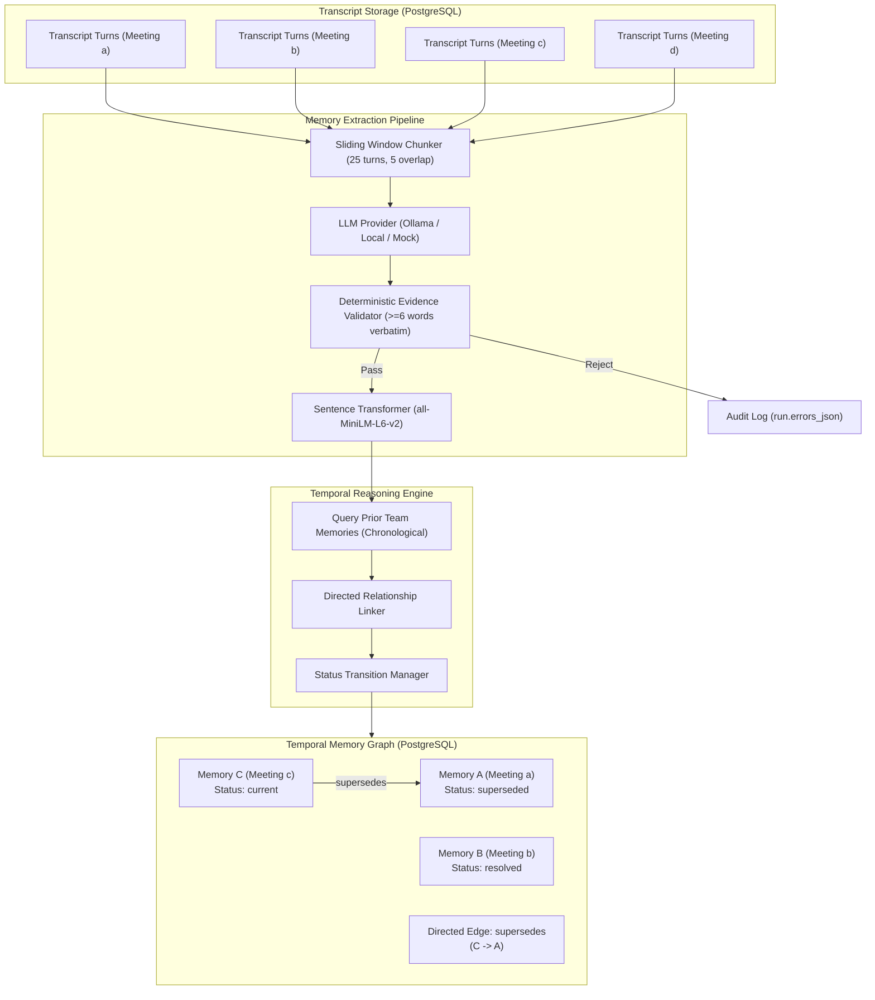
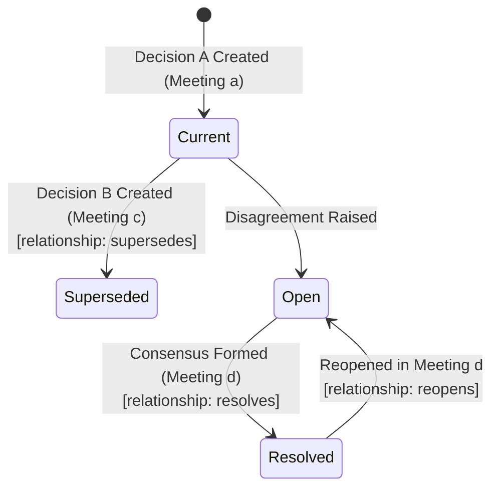

# Temporal Meeting Memory Pipeline

## 1. Overview and Design Objectives

The Temporal Meeting Memory pipeline transforms raw, ingested transcript turns into an append-only, chronologically-aware graph of atomic memories. Teams in the AMI Meeting Corpus design remote controls across 3–4 sequential meetings (`a` through `d`). During this process:
- Initial decisions made in meeting `a` are frequently altered, superseded, or rejected in meetings `b`, `c`, or `d`.
- Actions assigned in meeting `a` are resolved or carried forward in later sessions.
- Technical, functional, or aesthetic disagreements are debated, consensus is formed, or conflicts remain open.

The pipeline ensures:
1. **Historical Immutability**: Early memories are never deleted or rewritten.
2. **Deterministic Ground-Truth Citations**: Every memory references a specific transcript turn and contains an exact verbatim quotation of at least 6 consecutive words.
3. **Directed Temporal Graph**: Chronological links (`supersedes`, `updates`, `resolves`, `reopens`, `supports`, `contradicts`) connect newer memories to older memories.
4. **Ambiguity Preservation**: When evidence is uncertain, relationships are flagged as `is_ambiguous=True` and do not prematurely alter lifecycle statuses.

---

## 2. Extraction & Temporal Architecture

---

## 3. Atomic Memory Types

| Memory Type | Description | Initial Status | Example Statement |
|---|---|---|---|
| `DECISION` | Concrete technical, structural, or aesthetic choices | `current` | "The team decided to use kinetic battery power." |
| `ACTION` | Assigned tasks, commitments, next steps | `open` | "Speaker B will investigate rubber supplier quotes." |
| `PREFERENCE` | Stated user or stakeholder preferences | `current` | "Corporate customers prefer a slim, rounded shape." |
| `REQUIREMENT` | Fixed functional, mechanical, or cost constraints | `current` | "Production cost must remain under 12.50 Euros." |
| `DISAGREEMENT` | Explicit conflicts or opposing perspectives | `open` | "Disagreement between Speaker A and Speaker C over LCD screen necessity." |
| `ENTITY` | Core components, materials, or target market | `current` | "Remote uses double-curved rubber housing." |

---

## 4. Directed Relationship Types

- `supersedes`: A later decision replaces an earlier decision on the same topic. The prior decision is transitioned to `status="superseded"`.
- `updates`: A later statement refines or supplements prior information without replacement.
- `resolves`: An action item is completed, or a prior disagreement is resolved by team consensus.
- `reopens`: A previously settled topic or closed disagreement is brought back up for debate.
- `supports`: New evidence or agreement reaffirms a prior decision.
- `contradicts`: An opposing statement conflicts with an earlier assertion without an explicit decision to supersede.

---

## 5. Decision Supersession Lifecycle

---

## 6. Verbatim Quotation Validation Protocol

1. **Length Gate**: Quotes must have at least 6 consecutive words. Shorter strings are rejected to prevent vague single-word claims.
2. **Whitespace Normalization**: Consecutive whitespace, linebreaks, and tabs are normalized to a single space, and comparison is lowercase-insensitive.
3. **Substring Matching**: The normalized quote string must appear verbatim in the referenced `TranscriptTurn.raw_text`.
4. **Speaker Verification**: The candidate's `speaker_label` must match the turn's speaker.
5. **Action Ownership Guard**: If an action specifies an owner, the owner's name, role, or speaker letter must be present in the turn text.

