# Team TS3012 Pre-Meeting Briefing Pipeline

## 1. Architectural Overview

The **Pre-Meeting Briefing Pipeline** synthesizes a comprehensive, verifiable intelligence brief for Team TS3012 (and any team in the corpus) prior to their upcoming working session (e.g. before their final meeting `TS3012d`). The pipeline translates unstructured multi-hour transcripts and structured temporal memory graphs into an actionable 9-section Markdown briefing backed by claim-level verbatim citations.

```mermaid
flowchart TD
    Req["API / CLI Request<br/>(team_code: TS3012, target: TS3012d)"] --> FetchMeetings["1. Chronological Meeting Retrieval<br/>(TS3012a, TS3012b, TS3012c)"]
    
    FetchMeetings --> DetectGaps{"Check Sequence Gaps<br/>(e.g. missing b?)"}
    DetectGaps --> ExtractRoster["2. Speaker Roster & Roles<br/>(Mark=PM, Nick=UI, Xavier=ID, Dirk=MKT)"]
    
    ExtractRoster --> QueryMemories["3. Temporal Memory Graph Query<br/>(DECISION, ACTION, DISAGREEMENT)"]
    QueryMemories --> ResolveDecisions["4. Decision Supersession Resolution<br/>Current vs Superseded (Rubber > Plastic)"]
    
    ResolveDecisions --> BuildTimeline["5. Chronological Timeline Construction<br/>(Meeting Topics, Decisions, Milestones)"]
    BuildTimeline --> FilterActions["6. Open Actions & Owner Attribution<br/>(Explicit vs Unknown Confidence)"]
    FilterActions --> DetectDisputes["7. Unresolved Disagreements<br/>(e.g. Removable Fruit Cover)"]
    
    DetectDisputes --> SynthesizeDoc["8. Markdown Document Synthesis<br/>(9 Prescribed Sections)"]
    SynthesizeDoc --> ValidateCites["9. Claim-Level Citation Validation<br/>(CitationValidationService >=6 words)"]
    
    ValidateCites --> PersistDB["10. Versioned Persistence<br/>(Table: briefings, Version N+1)"]
    PersistDB --> Resp["Return BriefingResponse / CLI Output"]

    classDef node fill:#1e293b,stroke:#3b82f6,stroke-width:2px,color:#f8fafc;
    classDef branch fill:#334155,stroke:#f59e0b,stroke-width:2px,color:#f8fafc;
    class Req,FetchMeetings,ExtractRoster,QueryMemories,ResolveDecisions,BuildTimeline,FilterActions,DetectDisputes,SynthesizeDoc,ValidateCites,PersistDB,Resp node;
    class DetectGaps branch;
```

---

## 2. The 9 Required Briefing Sections

The briefing structure strictly implements Section 7 of the Catalist build-test specification:

| Section # | Section Title | Contents & Evidence Requirements |
|---|---|---|
| **1** | **Team and Meeting Coverage** | Target team code, upcoming meeting code, list of analyzed historical meetings in order, speaker roster with roles, and explicit disclosure of missing sequences. |
| **2** | **Executive Summary** | High-level synthesis of project progress: 25 Euro selling price target, ergonomic rubber casing with spongy feel, LCD screen and speech recognition, basic battery power, and key open decisions before finalization. |
| **3** | **Meeting Timeline** | Chronological breakdown of each covered meeting: sequence letter, order, discussion topics, major decisions, changes, open actions, and supporting turn citations. |
| **4** | **Current Decisions** | Confirmed latest decisions (excluding superseded ones): statement, meeting code, speaker label/role, exact quotation ($\ge 6$ words), and `CURRENT` status. |
| **5** | **Changes in Decisions** | Decision evolutions: historical decision vs updated decision, previous meeting vs updated meeting, supporting quotations for *both* points in time, and explicit rationale. |
| **6** | **Open Actions and Owners** | Outstanding tasks and commitments: description, assigned owner, owner confidence (`EXPLICIT` vs `UNKNOWN`), originating meeting, status (`OPEN`), and verbatim quotation. |
| **7** | **Unresolved Disagreements** | Active points of friction: disputed issue (e.g. removable fruit cover vs fixed casing), competing positions, involved speakers, supporting citations, and resolution status (`UNRESOLVED`). |
| **8** | **Items Requiring Attention** | Actionable pre-meeting checklist: removable cover decision, component cost reconciliation against 25 Euro ceiling, technical drawing review, and yellow rubber tooling costs. |
| **9** | **Evidence and Coverage Limitations** | Explicit boundary disclosure: meetings analyzed vs total, unrecorded off-record interactions (personal coach, lunch, emails), attribution certainty, and deterministic verification stats. |

---

## 3. Decision Supersession & Temporal Evolution

The pipeline prevents confusing earlier exploratory proposals with final confirmed decisions by traversing `MemoryRelationship` edges:

$$\text{Decision}(t_2) \xrightarrow{\text{SUPERSEDES}} \text{Decision}(t_1)$$

- **Case Material Evolution**:
  - *Meeting TS3012b (Speaker B)*: Leaned towards plastic casing to accommodate curves:  
    `"I think we should definitely go for plastic because I have curves in my design."`
  - *Meeting TS3012c (Speaker A)*: Switched to rubber casing for drop protection and spongy texture:  
    `"Okay, so we are definitely going for rubber for the outer casing."`
  - *Outcome*: Plastic marked `SUPERSEDED`; Rubber marked `CURRENT`; Decision change logged with citations from both meetings and user research rationale from Milan/Paris.
- **Power Source Evaluation**:
  - *Meeting TS3012c (Speaker C)*: Proposed kinetic energy provision.
  - *Meeting TS3012c (Speaker A)*: Pushed back that remotes sit stationary while watches move constantly.
  - *Outcome*: Basic normal battery confirmed as `CURRENT` decision:  
    `"This is really a really basic battery, a normal battery rather than kinetic provision."`

---

## 4. Open Actions & Strict Owner Attribution Policy

In accordance with strict assessment rules:
- **Do not infer ownership from job roles alone**: A task is marked with `owner_confidence = "EXPLICIT"` only when an individual is directly assigned or named in the transcript turn.
- Where conversational records omit an explicit assignee, the owner is reported as `"Unknown / Unassigned"` with `owner_confidence = "UNKNOWN"`.
- Completed or resolved commitments are excluded from the active open actions list.

---

## 5. Claim-Level Citation Validation

Every factual quotation in the briefing passes through `CitationValidationService.validate_citation()`:
1. **Meeting Verification**: The meeting ID exists and belongs to the target team.
2. **Turn Containment**: The quotation exists verbatim within a single speaker turn record.
3. **Word Count**: Strictly enforces $\ge 6$ whitespace-separated words.
4. **Speaker Label & Role**: Validated against speaker metadata stored in PostgreSQL.
5. **No Generative Quotes**: If evidence is unavailable, the claim is omitted or noted as unknown.

---

## 6. Persistence and Versioning

Briefings are stored in the `briefings` table:
- **Automatic Version Increment**: Calling `generate_briefing` with `regenerate=True` increments the version number ($V_1 \rightarrow V_2 \rightarrow V_3$).
- **Caching**: Calling `generate_briefing` with `regenerate=False` returns the existing latest version immediately.
- **Auditability**: Complete structured JSON payload, generation metadata, duration, and validation errors are persisted alongside the Markdown report.
