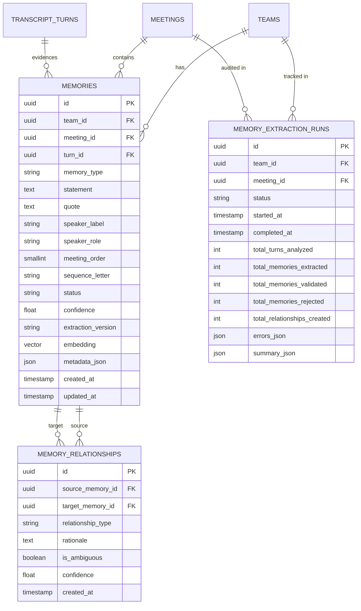

# Database Schema: Temporal Meeting Memory

## 1. Overview

The temporal memory schema persists atomic memories, directed chronological edges, and execution audit runs. It is implemented in Alembic migration `003_temporal_memory_schema.py` and models in `backend/app/models/memory.py`.

---

## 2. Entity-Relationship Diagram

---

## 3. Table Specifications

### 3.1 `memories`
- `id` (UUID, PK): Unique memory identifier.
- `team_id` (UUID, FK -> `teams.id`, CASCADE): Team scope.
- `meeting_id` (UUID, FK -> `meetings.id`, CASCADE): Origin meeting.
- `turn_id` (UUID, FK -> `transcript_turns.id`, SET NULL): Supporting speaker turn evidence.
- `memory_type` (VARCHAR(32)): `DECISION`, `ACTION`, `PREFERENCE`, `REQUIREMENT`, `DISAGREEMENT`, `ENTITY`.
- `statement` (TEXT): Synthesized, atomic claim or decision statement.
- `quote` (TEXT): Exact verbatim quotation from the supporting turn (>= 6 words).
- `speaker_label` (VARCHAR(32)): E.g., `Speaker A`, `Speaker B`.
- `speaker_role` (VARCHAR(64), nullable): E.g., `Project Manager`, `Industrial Designer`.
- `meeting_order` (SMALLINT): Numeric meeting order in team series (1 to 4).
- `sequence_letter` (VARCHAR(4)): Letter identifier (`a`, `b`, `c`, `d`).
- `status` (VARCHAR(32)): `current`, `superseded`, `open`, `resolved`, `rejected`.
- `confidence` (FLOAT): Extraction confidence (0.0 to 1.0).
- `extraction_version` (VARCHAR(32)): Version tag of extraction engine (e.g. `1.0.0`).
- `embedding` (VECTOR(384)): Dense vector embedding for similarity search (mapped to `Text` in SQLite testing).
- `metadata_json` (JSON): Structured attributes (`topic`, `owner`, `cost_estimate`, etc.).
- `created_at` / `updated_at` (TIMESTAMPTZ): Audit timestamps.

**Indexes:**
- `ix_memories_team_id`
- `ix_memories_meeting_id`
- `ix_memories_turn_id`
- `ix_memories_memory_type`
- `ix_memories_status`
- `idx_memories_team_type_status` (`team_id`, `memory_type`, `status`)
- `idx_memories_meeting_order` (`meeting_id`, `meeting_order`)
- `idx_memories_embedding_hnsw` (`embedding vector_cosine_ops`)

### 3.2 `memory_relationships`
- `id` (UUID, PK): Edge identifier.
- `source_memory_id` (UUID, FK -> `memories.id`, CASCADE): Newer memory originating the relationship.
- `target_memory_id` (UUID, FK -> `memories.id`, CASCADE): Older memory being referenced.
- `relationship_type` (VARCHAR(32)): `supports`, `contradicts`, `updates`, `supersedes`, `resolves`, `reopens`.
- `rationale` (TEXT, nullable): Explanation of why the relationship exists.
- `is_ambiguous` (BOOLEAN): Flag indicating whether the change is tentative or uncertain.
- `confidence` (FLOAT): Confidence score of the relationship edge.
- `created_at` (TIMESTAMPTZ): Edge creation timestamp.

**Constraints & Indexes:**
- Unique Constraint: `uq_memory_rel_source_target_type` on `(source_memory_id, target_memory_id, relationship_type)`.
- Foreign key indexes on `source_memory_id`, `target_memory_id`, `relationship_type`.

### 3.3 `memory_extraction_runs`
- `id` (UUID, PK): Unique run identifier.
- `team_id` (UUID, FK -> `teams.id`, SET NULL): Target team (if team run).
- `meeting_id` (UUID, FK -> `meetings.id`, SET NULL): Target meeting.
- `status` (VARCHAR(32)): `PENDING`, `RUNNING`, `COMPLETED`, `FAILED`.
- `started_at` / `completed_at` (TIMESTAMPTZ): Execution window.
- Metric Counters: `total_turns_analyzed`, `total_memories_extracted`, `total_memories_validated`, `total_memories_rejected`, `total_relationships_created`.
- `errors_json` (JSON): List of candidate rejections and errors with verbatim citation failure reasons.
- `summary_json` (JSON): Run summary metadata.
